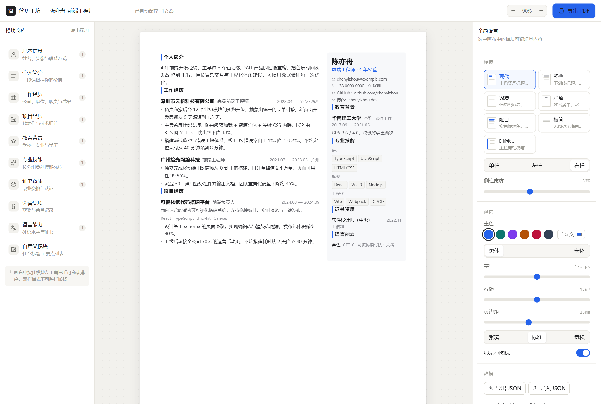
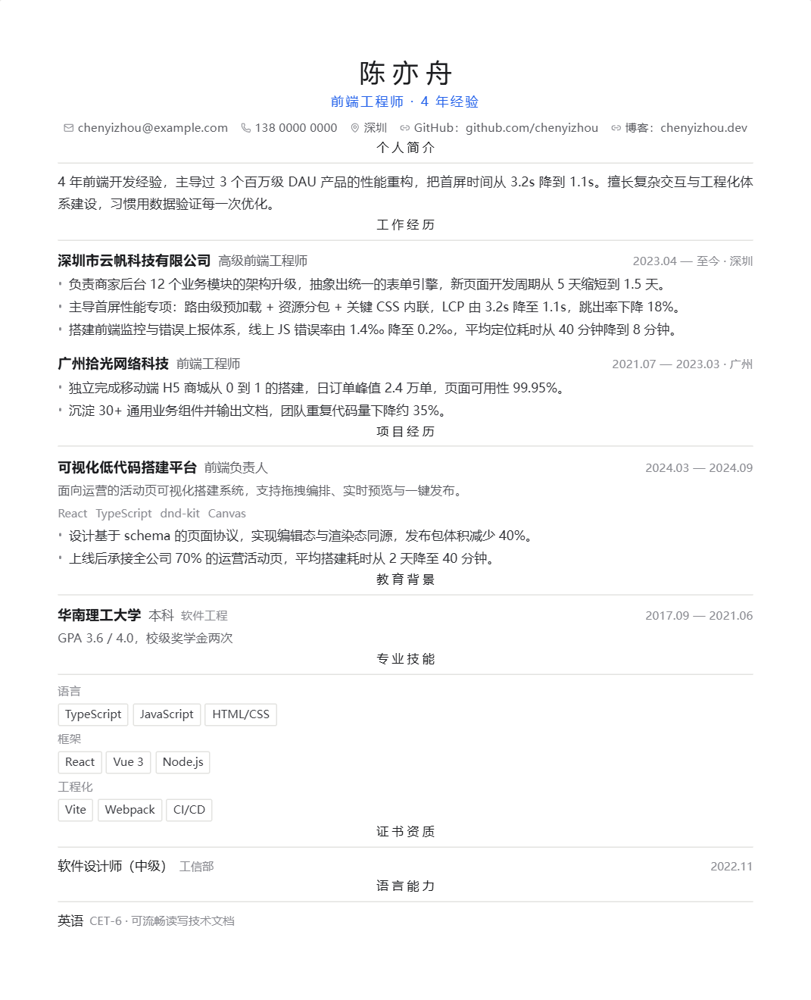

# 简历工坊 · 模块化简历生成器



浏览器里打开就能用的简历工具：模块化编辑、整块拖拽排版、头像上传、一键导出矢量 PDF。无后端、无登录，数据只存在本机浏览器。

## 快速开始

**Windows 一键启停**

- 双击 `start.bat`：首次会自动装依赖，随后启动服务并打开 http://localhost:5183
- 双击 `stop.bat`：结束服务并释放端口

**命令行**

```bash
npm install
npm run dev      # http://localhost:5183
npm run build    # 类型检查 + 生产构建
npm run preview  # 预览构建产物
```

> 服务端口固定 5183。启停逻辑在 `scripts/dev.ps1`，两个 .bat 只是双击入口。

## 已实现

- **10 类模块**：基本信息 / 个人简介 / 工作经历 / 项目经历 / 教育背景 / 专业技能 / 证书资质 / 荣誉奖项 / 语言能力 / 自定义模块
- **拖拽排版**：按住模块任意位置即可拖动（不用找把手），同列排序、双栏之间跨列搬移；键盘 `Ctrl/⌘ + ↑↓` 也能移动选中模块
- **A4 画布**：真实 210×297mm，可缩放 50%–150%，蓝色虚线标出分页位置
- **头像上传**：选中「基本信息」后点工具条上的相机按钮，或右侧面板里的头像框；自动方形裁切 + 压缩到 ≤120KB
- **7 套模板**：现代 / 经典 / 紧凑 / 雅致 / 醒目 / 极简 / 时间线；主色、字号、行距、页边距、密度可调

  
- **导出 PDF**：浏览器原生打印管道输出矢量文字（可选中、可被 ATS 解析），附带 ATS 安全模式
- **自动保存**：600ms 防抖写入本地，另有 JSON 导入/导出做跨机器备份

## 文档

- [软件工程启动方案](docs/00-SE启动方案.md)：需求清单、技术选型、架构分层、里程碑与验收标准
- [上传到 GitHub 完整步骤](docs/01-上传到GitHub完整步骤.md)：含认证方式、报错对照表、Pages 部署


## 目录结构

```
src/
├─ domain/            领域层（不依赖 React，可单测）
│  ├─ types.ts        文档与模块的完整类型
│  ├─ layout.ts       列的移动/重排/一致性收口
│  ├─ migrate.ts      导入数据的规整与版本迁移
│  ├─ defaults.ts     空白文档与示例文档
│  └─ blocks/registry.ts   ★ 模块注册表（唯一扩展点）
├─ blocks/            每个模块一个目录：Renderer + Editor
├─ store/             zustand + persist，所有写操作收口在 action
├─ features/          canvas / palette / inspector / toolbar / export
├─ components/        UI 原语、表单字段、头像上传
└─ styles/resume.css  纸面排版 + 7 套模板 + 打印契约

scripts/dev.ps1       一键启停逻辑（start.bat / stop.bat 调用）
```

## 新增一个模块

1. 新建 `src/blocks/Publication/index.tsx`，导出 `BlockModule` 对象（`Renderer` + `Editor` + `createData` + `isEmpty`）
2. 在 `src/domain/types.ts` 的 `BlockType`、`BlockDataMap`、`Block` 联合里各加一项
3. 在 `src/domain/blocks/registry.ts` 的 `BLOCK_REGISTRY` 和 `PALETTE_TYPES` 各加一行

画布、仓库、检查器、打印输出全部走注册表读取，**不需要改任何 switch-case**。

## 打印与 PDF

- `@page` 的页边距按当前「页边距」设置动态注入，因此每一页留白一致；`resume.css` 里另有 15mm/A4 兜底
- 编辑器 UI 通过 `@media print` 隐藏，纸面 DOM 与打印 DOM 是同一份，所见即所得
- 分页规则：章节标题不与正文分离，单条经历/要点不跨页
- 导出时会先关掉导出面板再唤起打印，避免弹窗被印进 PDF
- 导出时浏览器弹窗里需选择「另存为 PDF」，边距保持「默认」，并勾选「背景图形」

## 已知限制

- 单文件数据建议控制在 2MB 内（浏览器本地存储上限约 5MB），头像已自动压缩
- 双栏 + 复杂分页在不同浏览器下细节可能略有差异，建议导出后在目标阅读器里复核一次
- ATS 模式为纯 CSS 单栏化，侧栏内容会排在正文之后；若投递系统依赖自动筛选，建议直接用单栏模板
